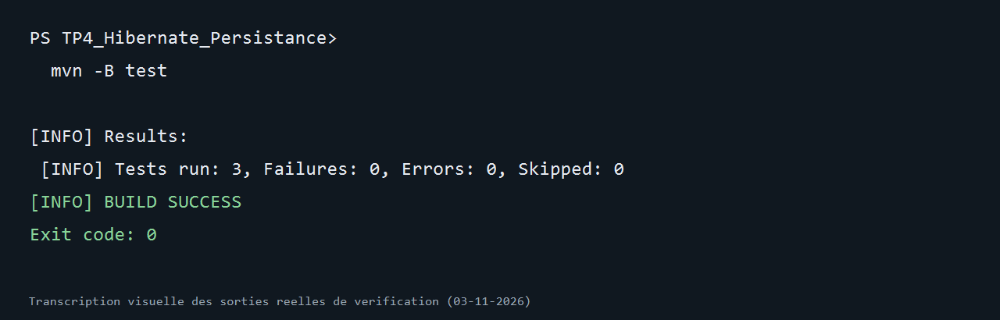

# TP4 — Hibernate et persistance des données

Projet Maven du [TP 4 du cours Architecture Microservices](https://mliaedu.toubkalit.com/student/courses/7/labs/153). Il met en place Hibernate 5.6.15.Final, MySQL, les entités `Salle` et `Machine`, une interface `IDao<T>`, des DAO, des services et une recherche HQL par marque.

## Prérequis

- JDK 17 ou plus récent
- Maven 3.6 ou plus récent
- MySQL 8 pour lancer la démonstration `test.MainTest`

## Structure

```text
src/main/java/
├── dao/       IDao<T>, SalleDao, MachineDao et gestion des transactions
├── entities/  Salle et Machine (association bidirectionnelle 1:N)
├── services/  SalleService et MachineService
├── util/      HibernateUtil et SessionFactory unique
└── test/      MainTest (démonstration MySQL)
src/main/resources/hibernate.cfg.xml
src/test/java/services/PersistenceIntegrationTest.java
src/test/resources/hibernate-test.cfg.xml
```

## Tester sans MySQL

Les tests d'intégration utilisent H2 en mémoire. Ils vérifient le CRUD des deux entités, leur association, la recherche HQL et le rollback après violation d'une contrainte unique.

```powershell
mvn clean test
```

## Exécuter avec MySQL

Créez la base de données vide :

```sql
CREATE DATABASE db_tp_hibernate CHARACTER SET utf8mb4 COLLATE utf8mb4_unicode_ci;
```

`src/main/resources/hibernate.cfg.xml` cible `localhost:3306`, l'utilisateur `root` et un mot de passe vide, comme dans le TP. Si votre installation diffère, fournissez les variables d'environnement `DB_URL`, `DB_USER` et `DB_PASSWORD` sans enregistrer de mot de passe dans Git :

```powershell
$env:DB_URL = 'jdbc:mysql://localhost:3306/db_tp_hibernate?useSSL=false&serverTimezone=UTC'
$env:DB_USER = 'root'
$env:DB_PASSWORD = 'votre_mot_de_passe'
mvn exec:java
```

`test.MainTest` insère une salle et une machine, puis recherche les machines Dell. Hibernate crée ou met à jour les tables `salles` et `machines` (`hbm2ddl.auto=update`). Les références reçoivent un suffixe temporel pour permettre plusieurs exécutions.

## Transactions et architecture

`AbstractHibernateDao` ouvre une session et une transaction pour chaque écriture. En cas d'échec, il effectue un rollback et lance `DaoException`. Les lectures utilisent des requêtes typées ; `MachineDao.findByMarque` utilise un paramètre HQL, sans concaténer la saisie dans la requête. Les services exposent les opérations métier et acceptent un DAO injecté, ce qui permet aux tests de leur fournir une `SessionFactory` H2.

## Importer dans Eclipse

Utilisez **File > Import > Maven > Existing Maven Projects**, puis choisissez ce dossier.

## Résultat vérifié

Commande exécutée le 3 novembre 2026 :

```powershell
mvn -B test
```

3 tests d’intégration réussis avec H2 (0 échec). La démonstration MySQL n’a pas été lancée.



L’image est une transcription visuelle de la sortie réelle de vérification ; la capture native de la fenêtre du terminal n’était pas disponible dans cet environnement.
